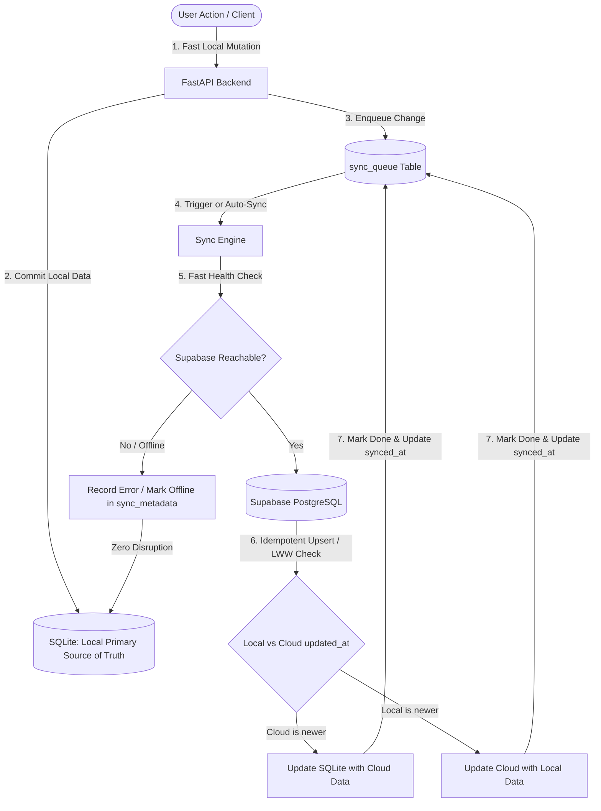

# DietSense Phase 4 — Local Cloud Synchronization Architecture & Implementation

## 1. Executive Summary

DietSense implements an **offline-first, resilient dual-database synchronization architecture**:
- **SQLite** operates locally as the authoritative, instant single source of truth (`database/dietsense.db`). User mutations (meal plans, logs, feedback, pantry, profile edits) always commit to SQLite first with sub-millisecond latency and zero network dependency.
- **Supabase PostgreSQL** (`aws-1-ap-south-1.pooler.supabase.com:6543/postgres`) functions as the durable cloud backup and cross-device synchronization target.
- A transactional **Pending Synchronization Queue** (`sync_queue`) records every local mutation along with metadata (`sync_metadata`), and asynchronously flushes changes to Supabase whenever network connectivity is verified.
- **Conflict Resolution** follows **Last-Write-Wins (LWW)** using ISO 8601 UTC timestamps (`updated_at`), strictly preventing older cloud or local states from overwriting newer data.
- **Network Resilience**: Network or Supabase unreachability never prevents the user from logging meals, adjusting meal plans, or scanning groceries. Unsynced mutations safely accumulate in SQLite and automatically replay when connectivity returns.

---

## 2. Synchronization Architecture



---

## 3. Database Schemas

### 3.1 Local SQLite Synchronization Queue

```sql
CREATE TABLE IF NOT EXISTS sync_queue (
    id TEXT PRIMARY KEY,
    user_id TEXT NOT NULL,
    entity_type TEXT NOT NULL,  -- 'profile', 'meal_plan', 'meal_log', 'feedback', 'pantry'
    entity_id TEXT NOT NULL,
    operation TEXT NOT NULL,    -- 'INSERT', 'UPDATE', 'UPSERT', 'DELETE'
    payload TEXT NOT NULL,      -- JSON serialized entity payload
    status TEXT DEFAULT 'pending', -- 'pending', 'syncing', 'done', 'failed'
    retry_count INTEGER DEFAULT 0,
    max_retries INTEGER DEFAULT 5,
    last_error TEXT,
    created_at TEXT NOT NULL,
    updated_at TEXT NOT NULL,
    FOREIGN KEY (user_id) REFERENCES users(id) ON DELETE CASCADE
);

CREATE INDEX IF NOT EXISTS idx_sync_queue_user_status ON sync_queue(user_id, status);
CREATE INDEX IF NOT EXISTS idx_sync_queue_entity ON sync_queue(entity_type, entity_id);
```

### 3.2 Local Synchronization Metadata

```sql
CREATE TABLE IF NOT EXISTS sync_metadata (
    user_id TEXT PRIMARY KEY,
    last_synced_at TEXT,
    last_attempt_at TEXT,
    sync_status TEXT DEFAULT 'idle', -- 'idle', 'in_progress', 'synced', 'error', 'offline'
    last_error TEXT,
    updated_at TEXT NOT NULL,
    FOREIGN KEY (user_id) REFERENCES users(id) ON DELETE CASCADE
);
```

### 3.3 Supabase Cloud PostgreSQL Tables

Every PostgreSQL table was upgraded via Migration 005 with stable deduplication keys and sync timestamps:
- `sqlite_id TEXT UNIQUE`: Guarantees idempotency. Even if a network packet drops after cloud write, repeating the sync will never create duplicate cloud rows.
- `synced_at TIMESTAMPTZ`: Timestamp when cloud confirmed receipt.
- `updated_at TIMESTAMPTZ`: Entity modification timestamp used for Last-Write-Wins conflict resolution.

---

## 4. Entity Synchronization Handlers

The synchronization engine (`backend/app/core/sync_service.py`) implements specialized synchronizers for all 5 core DietSense entities:

| Entity | SQLite Table | Supabase Table | Deduplication & Conflict Strategy |
| :--- | :--- | :--- | :--- |
| **Profile** | `profiles` | `public.profiles` | `ON CONFLICT (user_id) DO UPDATE`. Compares `updated_at` before overwriting. Pulls cloud profile if cloud is newer. |
| **Meal Plans** | `meal_plans` | `public.meal_plans` | `ON CONFLICT (sqlite_id) DO UPDATE`. JSONB serialized meal days and nutrition targets. |
| **Meal Logs** | `meal_logs` | `public.meal_logs` | `ON CONFLICT (sqlite_id) DO UPDATE`. Preserves skipped meals, skip reasons, and logged eaten items. |
| **Feedback** | `feedback` | `public.app_feedback` | `ON CONFLICT (sqlite_id) DO UPDATE`. Synchronizes satisfaction ratings, energy levels, and tags. |
| **Pantry** | `pantry_items` | `public.pantry_items` | `ON CONFLICT (user_id, name) DO UPDATE`. Handles `DELETE` and `UPSERT` operations. |

---

## 5. Conflict Resolution Strategy: Last-Write-Wins (LWW)

1. **Timestamp Standard**: All records locally and remotely use UTC ISO 8601 timestamps (`updated_at`).
2. **Pre-Write Conflict Inspection**:
   - Before applying a local mutation to Supabase, the sync worker queries the corresponding cloud record's `updated_at`.
   - If `cloud.updated_at > local.updated_at`, the cloud record was updated more recently (e.g. from another device or concurrent session). The sync engine **does not overwrite** the cloud record; instead, it adopts the cloud record locally, updates SQLite, marks the queue item as `done`, and updates `synced_at`.
   - If `local.updated_at >= cloud.updated_at`, the local record is pushed to Supabase via `ON CONFLICT (sqlite_id) DO UPDATE`.
3. **Idempotence**: Repeating a synchronization operation multiple times results in the identical final state without duplicates or integrity errors.

---

## 6. Network Resilience & Availability Guardrails

- **Fast Supabase Connection Timeout (2s)**: Avoids blocking API responses if Supabase pooler has latency spikes.
- **Health Check TTL Caching (10s)**: `is_supabase_available()` caches availability status to prevent repetitive TCP handshakes.
- **Fail-Safe Offline Mode**: If a network failure occurs during `/api/sync/trigger`:
  - `sync_metadata` marks `sync_status = 'error'` or `'offline'`.
  - Queue items remain intact as `pending` with incremented retry counts and error descriptions.
  - The local application continues normal execution with zero crashes or data loss.

---

## 7. API Endpoints

### `GET /api/sync/status`
Returns the current synchronization status, queue statistics, and cloud reachability.
```json
{
  "status": "synced",
  "cloud_available": true,
  "pending_count": 0,
  "failed_count": 0,
  "last_synced_at": "2026-11-17T15:40:00Z",
  "last_attempt_at": "2026-11-17T15:40:02Z",
  "last_error": null
}
```

### `POST /api/sync/trigger`
Pushes all pending items for the authenticated user to Supabase.

### `POST /api/sync/retry`
Resets failed queue items (`status = 'failed'`) back to `'pending'` and re-executes synchronization.

---

## 8. Frontend Integration

1. **`SyncContext` (`frontend/src/context/SyncContext.tsx`)**:
   - Manages live synchronization state across the application.
   - Listens to `window.addEventListener("online")` to **automatically trigger synchronization** the instant network returns.
   - Listens to `window.addEventListener("offline")` to smoothly adjust UI state.
   - Refreshes status on window focus and every 30 seconds.
2. **`SyncStatusIndicator` (`frontend/src/components/SyncStatusIndicator.tsx`)**:
   - Integrated into the global `Header.tsx`.
   - Visual status pills:
     - 🟢 **Synced**: Cloud state is up to date.
     - 🟡 **Syncing... / N Pending**: Background transmission active.
     - ⚪ **Offline (Local)**: Local SQLite running reliably offline.
     - 🔴 **Sync Error**: Detailed notification with one-click **Retry** button.
   - Interactive popover reveals pending/failed counts, last sync timestamp, and "Sync Now" button.

---

## 9. Verification & Automated Test Coverage

The test suite in `tests/test_phase4_sync.py` validates all Phase 4 requirements:

1. `test_offline_data_creation_enqueues_mutations`: Verifies local mutations write immediately to SQLite and queue mutations without requiring cloud connectivity.
2. `test_successful_synchronization_flow`: Verifies end-to-end pushing of profiles, meal plans, meal logs, feedback, and pantry items to Supabase PostgreSQL.
3. `test_failed_synchronization_and_resilience`: Verifies that simulated network disconnects do not crash the app, retaining pending items for future retry.
4. `test_retry_handling_resets_and_retries`: Confirms failed items are reset to `pending` and successfully re-synced on retry.
5. `test_duplicate_prevention_on_repeated_sync`: Asserts `sqlite_id UNIQUE` idempotency prevents duplicate rows across repeated sync cycles.
6. `test_conflict_resolution_last_write_wins`: Asserts that when cloud data is newer, older local edits do not overwrite newer cloud data.
7. `test_recovery_after_reconnecting`: Verifies full automatic recovery of accumulated offline mutations once connection is restored.

**Suite Status**: **75 / 75 passing (100%)**.
